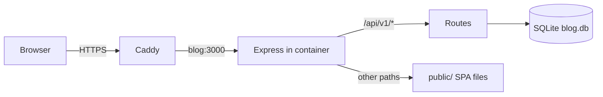
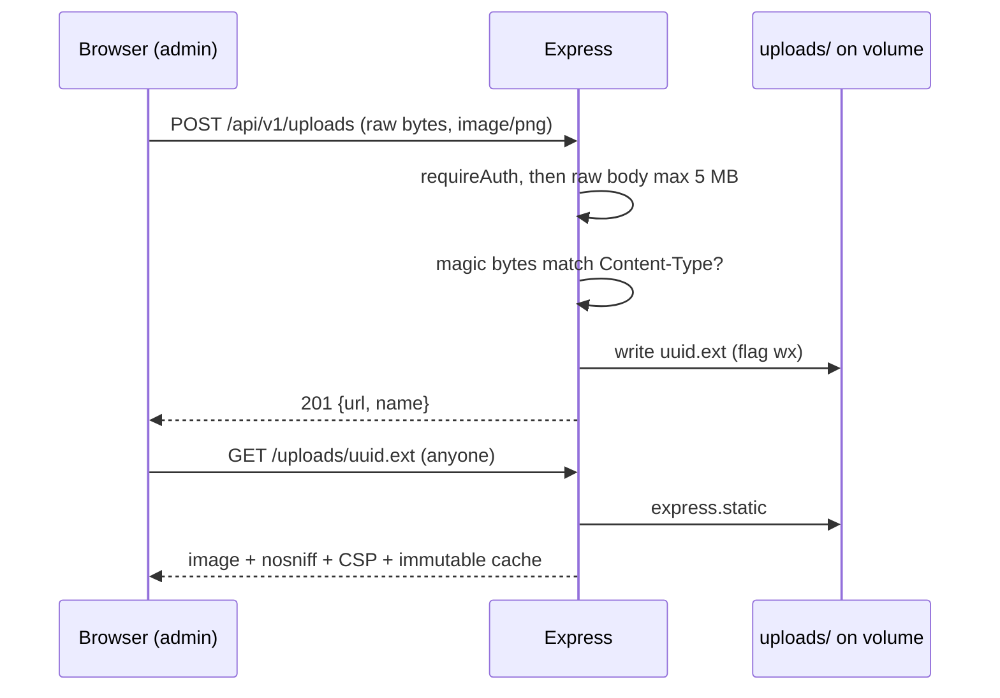
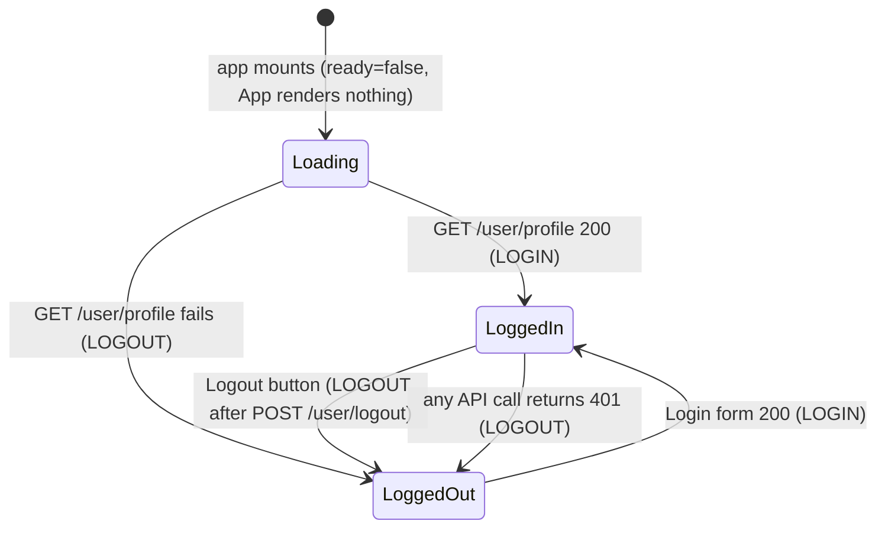
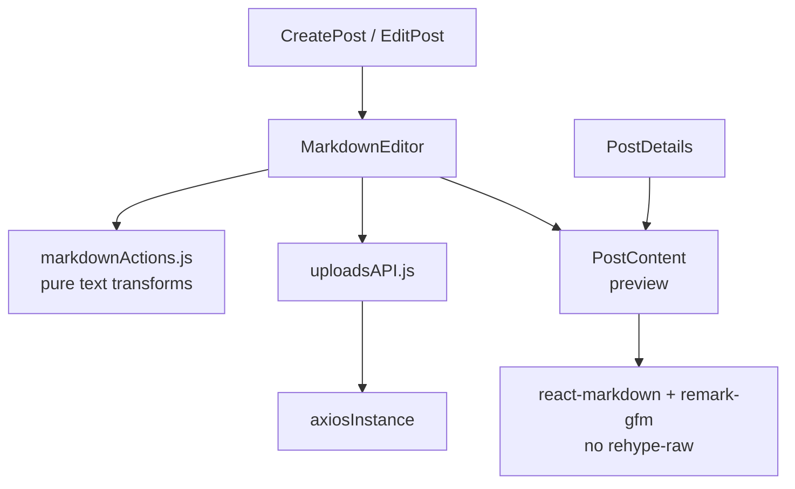
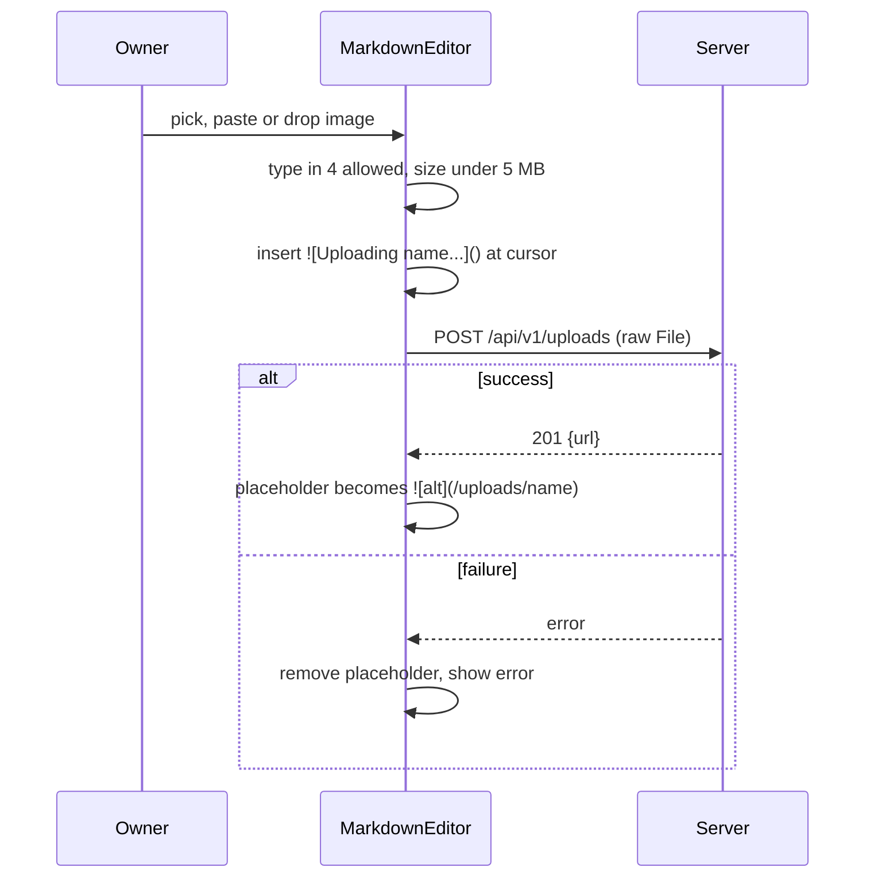
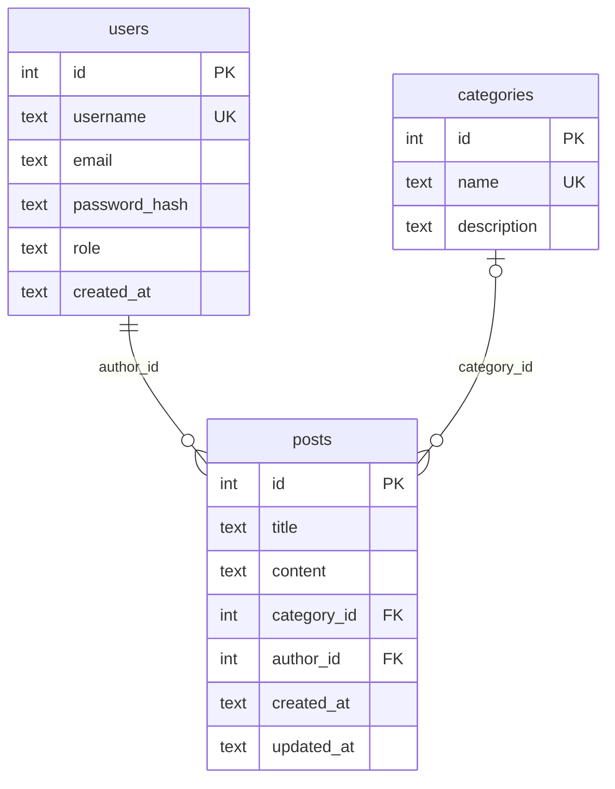
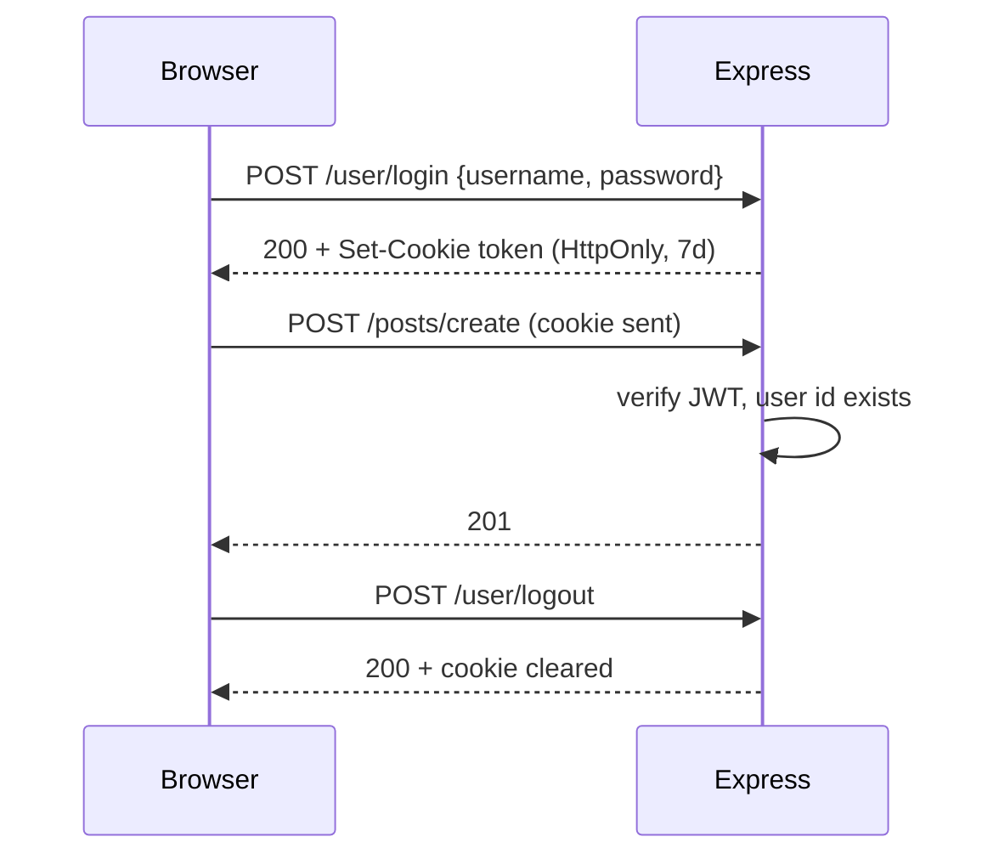
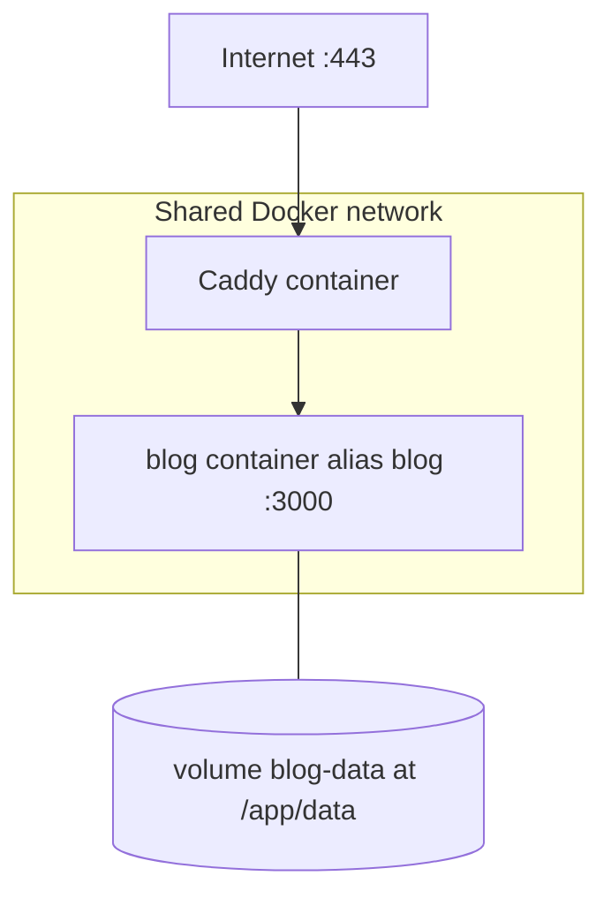

# Architecture

Status (2026-10-05): backend verified against `backend-lite/src` (Phase 1, Phase 7 uploads). Frontend read from `frontend/src` (Phases 3 and 7; build verified, browser click-through not done). Container verified by running a patched copy of the Dockerfile (see [milestones.md](milestones.md#phase-4-containerize)); the committed Dockerfile now builds (lead-confirmed; the full checks used an equivalent patched copy). Caddy and the droplet (Phase 5) are not started.

BlogMe Lite is a single-author blog: one Docker container (Express serving the API and the built React app) with one SQLite file on a volume, behind Caddy at `blog.<domain>`.

## Components and request flow

- `/api/v1/*` goes to the routers. Any other `/api/...` path gets a JSON 404 before the SPA fallback is reached.
- If `public/index.html` exists (the Docker image copies the built frontend there), Express serves `public/` statically and answers every other GET with `index.html` so React Router handles the path. If it does not exist (local backend dev), this is skipped and unknown paths get the JSON 404. Verified in a container (`/` and `/posts/1` return HTML, `/api/v1/nope` returns JSON 404).
- Middleware order in `app.js`: `cors` (non-production only), `express.json` (100 KB), `cookie-parser`, `/health`, the four routers (user, posts, category, uploads), `/api` 404, `/uploads` static, `public/` static + SPA fallback (only if built), final 404, error handler.
- The fallback is `GET *` only; other methods on unknown non-API paths get the JSON 404.
- `GET /health` is outside `/api/v1`.

## Image uploads (Phase 7, server side; the browser side is under [Frontend](#markdown-editor-phase-7))

- `/uploads` is mounted before the SPA fallback, with `fallthrough: false`, so a missing file is a JSON 404 and never `index.html`. `index: false` and `redirect: false` mean no directory listing.
- The directory is `UPLOAD_DIR` (a relative value resolves against `backend-lite/`), else `<DB dir>/uploads`, else a fresh temp dir when `DB_PATH=:memory:` (see `uploadDir.js`). In the container that is `/app/data/uploads`, inside the `blog-data` volume. The `:memory:` branch was run once (server started, temp dir created) but not exercised further.
- Images are stored and served as-is; nothing in the database references them. A post only holds Markdown text pointing at `/uploads/<name>`.

## Frontend (`frontend/`)

React 18, Vite, MUI, React Router 6, `react-markdown` with `remark-gfm`. One HTTP client: `src/utils/axiosInstance.js` with `baseURL = (VITE_API_URL ?? "") + "/api/v1"` and `withCredentials: true`. In production the frontend is same-origin, so `VITE_API_URL` is unset; in dev Vite proxies `/api` and `/uploads` to `http://localhost:3000` (`vite.config.js`), so it is unset there too.

Auth state lives in `AuthContext` (a reducer with `user` and `ready`). Nothing is stored in `localStorage`; the session is the HttpOnly cookie.

- The 401 interceptor in `axiosInstance` calls a handler that `AuthContext` registers on mount; it dispatches `LOGOUT`.
- The Logout button dispatches `LOGOUT` and navigates to `/` even if the logout request fails.
- Routes (`App.jsx`): `/`, `/list`, `/login`, `/posts/:id`, `/categories` are public. `/create-post`, `/edit-post/:id`, `/create-category`, `/edit-category/:id` redirect to `/login` when logged out (UI only; the API enforces auth). Anything else renders the `NotFound` page.
- The navbar is `PrivateNav` when `user` is set, otherwise `PublicNav`.
- Post content is rendered as Markdown (`PostDetails`); `EditPost` has a category select; `CategoryCard` shows `postCount`.
- Removed from the old frontend: Register and ForgotPassword pages, likes, and the Mongo-era image upload. Phase 7 added a Markdown editor with image upload (below).
- Unverified in a browser: all of the UI behavior above, the editor below and the GFM styling (only `npm run build`, the `markdownActions` Node checks, and login, upload and fetch through the Vite proxy with `curl` were checked).

### Markdown editor (Phase 7)

- Custom component, no new dependency. Toolbar: bold, italic, heading, bullet list, numbered list, quote, inline code, code block, link, image. Below the `md` breakpoint a Write/Preview toggle; at `md` and up, text box and preview side by side.
- `PostContent` is the single renderer for the preview and the post page. `remark-gfm` adds tables (wrapped in a horizontal scroll div, theme divider borders), strikethrough, task lists (disabled checkboxes) and bare-URL autolinks. No `rehype-raw`, so raw HTML is escaped and shown as text. Images are `loading="lazy"` and capped to the container width.
- `CreatePost` and `EditPost` pass `onBusyChange`; Save is disabled while any upload is pending.
- `PostCard` builds its list excerpt from the Markdown with images, table pipes and task markers removed.

Upload flow from the browser side (button, paste or drop):

- Replacement edits the latest text (a ref), so typing during an upload is not overwritten. Dev: Vite proxies `/uploads` as well as `/api`.

## Data model

- Deleting a category sets `posts.category_id` to NULL (`ON DELETE SET NULL`); posts survive.
- Foreign keys and WAL are enabled in `db.js`. Timestamps are ISO 8601 UTC text; `updated_at` is set explicitly on post updates.
- The API serializes to Mongo-style names (`_id`, `categoryName`, ...) in `serialize.js`; see [api/overview.md](api/overview.md).

## Auth flow

- Failure of any kind on login returns a generic 401 `Invalid credentials`. After 10 failures from one IP in 15 minutes, further attempts get 429 (in memory; see [api/overview.md](api/overview.md#post-userlogin)).
- The token is never in a response body. Cookie: `token`, HttpOnly, SameSite=Lax, 7 days, `Secure` when `NODE_ENV=production`.
- `requireAuth` verifies the JWT (HS256 only), then checks the user id still exists in `users`. Missing or invalid cookie, or a deleted user: 401.
- The JWT payload is only `sub` (user id); there is no role check.
- Logout is stateless: it only clears the cookie. There is no server-side revocation (confirmed in code): a copied token stays valid until it expires or `JWT_SECRET` changes. A password change does not end sessions either.

## Deployment topology

- The blog container publishes no ports; only Caddy is exposed.
- `docker-compose.yml` attaches `blog` to an external network named `${CADDY_NETWORK:-caddy}` with alias `blog`; the real network name on the droplet is unknown until Phase 5. Compose refuses to start if that network does not exist.
- `blog-data` holds `blog.db`, `backups/` and `uploads/`; it is the unit to back up and the unit `docker compose down -v` deletes.
- Memory limit `mem_limit: 300m`. Idle use seen in a test container: about 20 MiB.
- Image: two stages. Stage 1 builds the frontend. Stage 2 is the backend runtime with `NODE_ENV=production`, `DB_PATH=/app/data/blog.db`, `PORT=3000`, the frontend in `/app/public`, and `USER node`. `/app/data` is the `blog-data` volume.
- `docker-compose.dev.yml` (local only) publishes `127.0.0.1:3000` and swaps Caddy's network for the default one.

## Design decisions

| Decision | Reason |
|---|---|
| SQLite via `better-sqlite3`, no ORM | One file, no extra service, fits a 2 GB droplet. |
| One container serves API and frontend | One thing to run, no CORS in production. |
| JWT in HttpOnly cookie, `SameSite=Lax` | Script cannot read the token; replaces localStorage plus Bearer. |
| 7 day token, no refresh tokens | Single user; simplicity. |
| Generic 401 on login failure | The old 404 "User not found" leaked usernames. |
| No register route; `createAdmin.js` script | Only the owner needs an account; password is never in `.env`. |
| Mongo-style field names in the API | The frontend already reads them; avoids renaming on the frontend. |
| `updated_at` set explicitly | SQLite has no on-update trigger. |
| WAL mode and `db.backup()` for backups | Copying a live WAL file is unsafe; the image has no `sqlite3` CLI. |
| `node:22-slim` (both stages), not Alpine | Avoids `better-sqlite3` build problems and matches its `node >=22` requirement (`engines` is `>=22` too). The Dockerfile installs with `--ignore-scripts` because the slim image has no compiler. Node 20 was dropped because it is end of life; the vulnerability reduction was not measured (see [milestones.md](milestones.md#phase-4-containerize)). |
| Frontend uses one axios instance, cookie only, no `localStorage` | The token is not readable by script; a 401 anywhere logs the UI out. |
| `cors` loaded in dev only | Production is same-origin. |
| `trust proxy` = 1 | Caddy is the single proxy, so the rate limit sees the real client IP. |
| Login rate limit: in-memory map, failures only, 10 per IP per 15 min | Single process, single user; no extra dependency. Lost on restart, which is acceptable. |
| Writes require `application/json` (415 otherwise) | PLAN.md requires it; the frontend only sends JSON (it also rules out form-encoded cross-site posts, inferred rationale). |
| `JWT_SECRET` required in every environment | A missing secret must never fall back to a default. |
| Upload body is raw bytes (`express.raw`), not multer or multipart | No extra dependency, no filename or field parsing; the client sends the `File` with its `Content-Type`. |
| Magic-byte check must match the declared type | `Content-Type` is client-controlled; only PNG, JPEG, GIF and WebP signatures are accepted. |
| SVG rejected | SVG can carry scripts; the four raster types cannot. |
| Server-made random name (UUID plus detected extension), written with `wx` | No path traversal, no overwrite, no reliance on the client filename. |
| `nosniff` and a sandbox CSP on `/uploads`, long immutable cache | Stops a mis-typed file being run as something else; names are unique and never change. |
| Uploads on the local volume, no cloud storage | One volume to back up; no external service. Cost: backups must cover `uploads/` too. |
| Out of scope: OAuth, cloud or multipart uploads (only the admin raw image upload exists), likes, comments, registration, drafts, slugs, pagination, search | Keep it lite; may come in Phase 6. |
| Custom Markdown editor, no editor library | No new dependency; the toolbar is small pure functions in `markdownActions.js`. |
| One `PostContent` renderer, no `rehype-raw` | Preview matches the published page; raw HTML in a post is never rendered. |

Image uploads were added in Phase 7 (see above).

Added during Phase 1: login rate limit (in memory, per IP), 415 on non-JSON writes, `requireJson` and `parseId` helpers in `middleware/http.js`, a `JWT_SECRET` check at startup in every environment.

## Still to verify

- [ ] Browser behavior of the frontend (Phase 3 click-through) and of the Phase 7 editor (see [writing-posts.md](writing-posts.md)).
- [ ] Caddy network name and the compose attachment on the droplet (Phase 5).
- [ ] Full container checks re-run against the committed Dockerfile (it builds; the checks used an equivalent patched copy).
