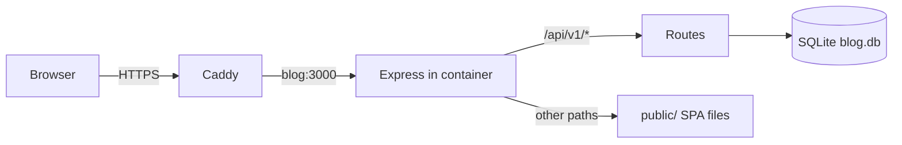
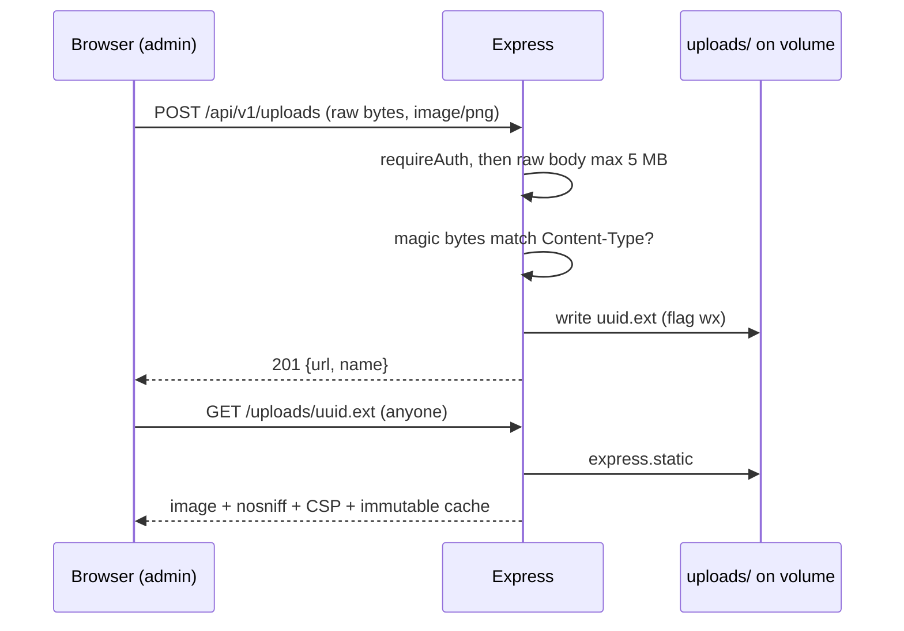
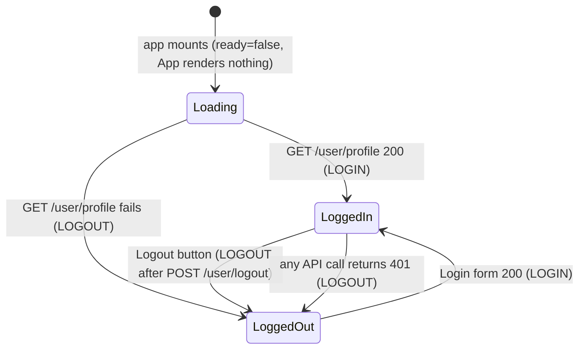
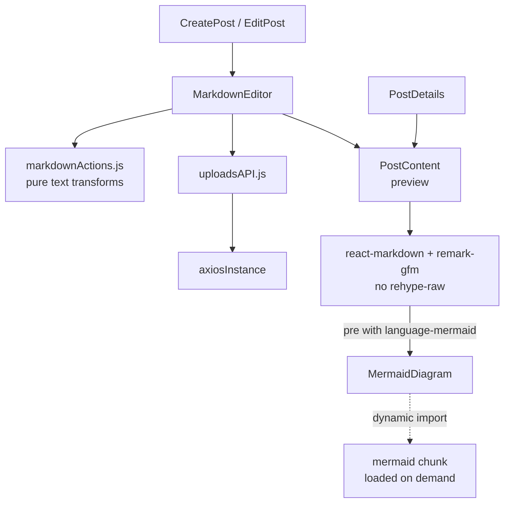
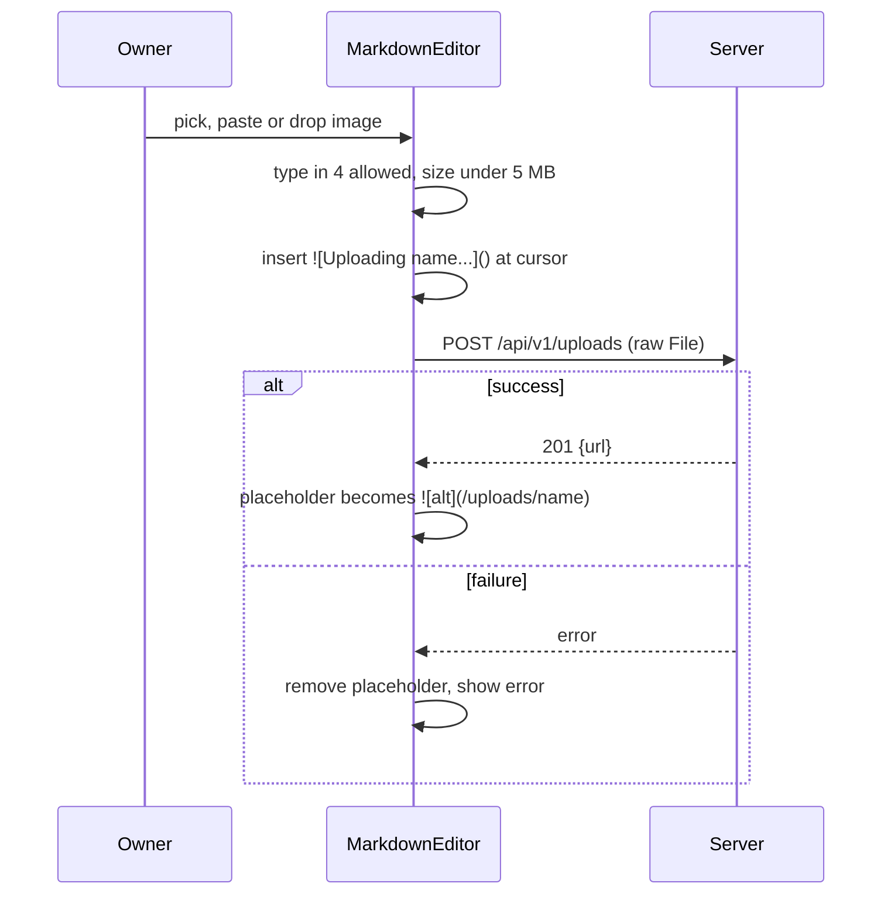
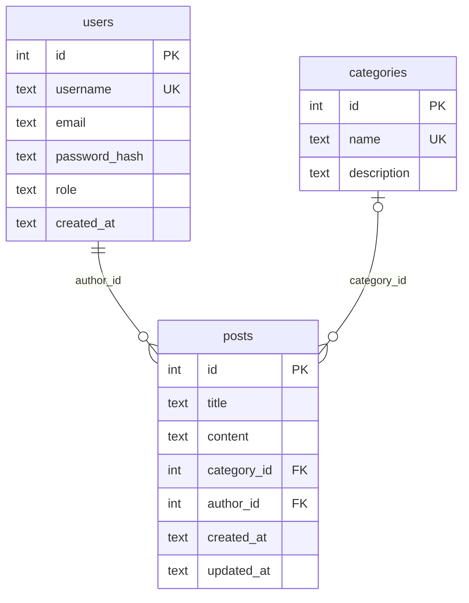
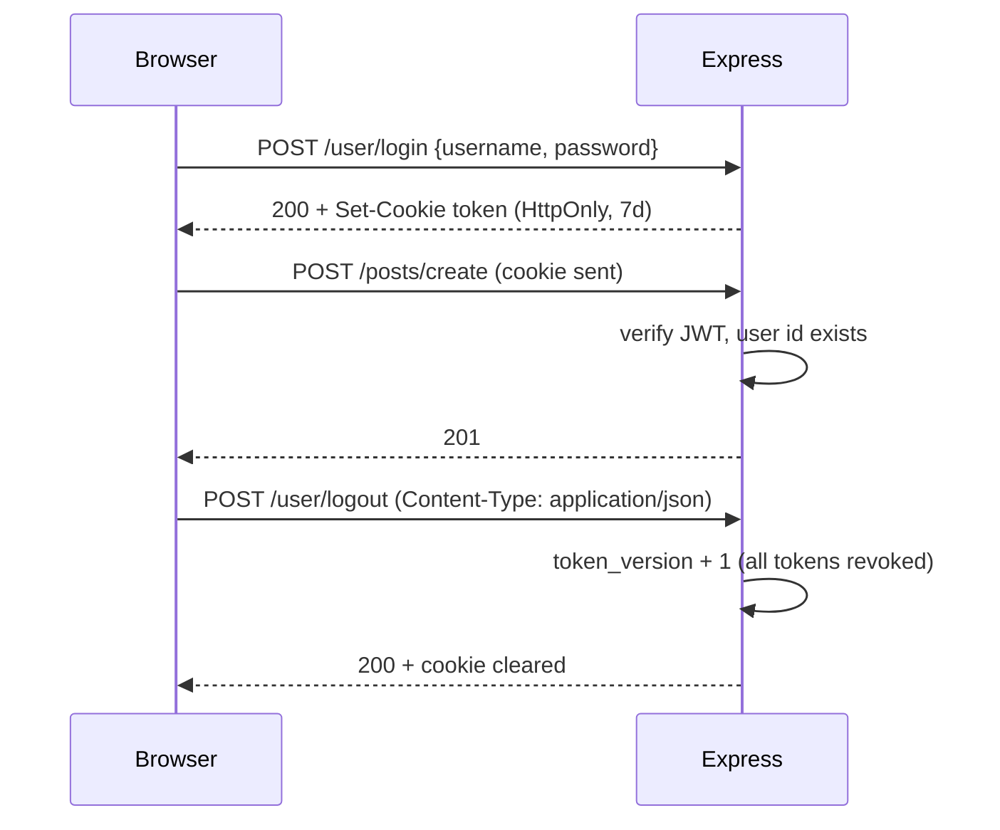
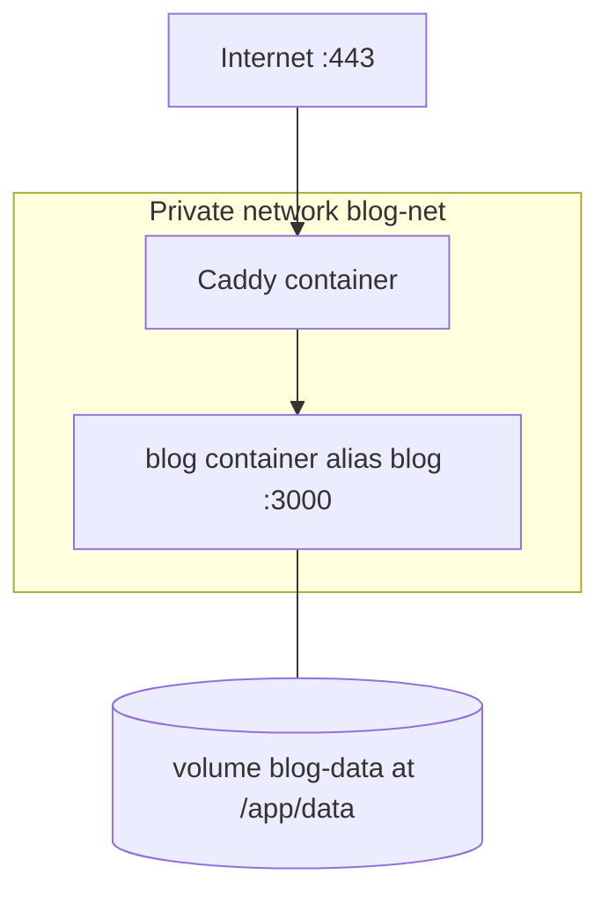

# Architecture

Status (2026-10-05): backend verified against `backend/src` (Phase 1, Phase 7 uploads). Frontend read from `frontend/src` (Phases 3 and 7; build verified, browser click-through not done). Container verified by running a patched copy of the Dockerfile (see [milestones.md](milestones.md#phase-4-containerize)); the committed Dockerfile now builds (lead-confirmed; the full checks used an equivalent patched copy). Caddy and the droplet (Phase 5) are not started. Public read-only frontend change (2026-10-11): build and curl checks verified, no browser click-through. Security hardening pass (2026-10-11, uncommitted when documented): read from the diff; 17 backend tests seen passing after fix pass 2; see [security.md](security.md).

BlogMe Lite is a single-author blog: one Docker container (Express serving the API and the built React app) with one SQLite file on a volume, behind Caddy at `blog.<domain>`.

## Components and request flow

- `/api/v1/*` goes to the routers. Any other `/api/...` path gets a JSON 404 before the SPA fallback is reached.
- If `public/index.html` exists (the Docker image copies the built frontend there), Express serves `public/` statically and answers every other GET with `index.html` so React Router handles the path. If it does not exist (local backend dev), this is skipped and unknown paths get the JSON 404. Verified in a container (`/` and `/posts/1` return HTML, `/api/v1/nope` returns JSON 404).
- Middleware order in `app.js`: `cors` (only when `NODE_ENV` is `development` or `test`), security headers (everything except `/uploads`), `express.json` (100 KB), `cookie-parser`, `/health`, the four routers (user, posts, category, uploads), `/api` 404, `/uploads` static, `public/` static + SPA fallback (only if built), final 404, error handler.
- The fallback is `GET *` only; other methods on unknown non-API paths get the JSON 404.
- `GET /health` is outside `/api/v1`.

## Image uploads (Phase 7, server side; the browser side is under [Frontend](#markdown-editor-phase-7))

- `/uploads` is mounted before the SPA fallback, with `fallthrough: false`, so a missing file is a JSON 404 and never `index.html`. `index: false` and `redirect: false` mean no directory listing.
- The directory is `UPLOAD_DIR` (a relative value resolves against `backend/`), else `<DB dir>/uploads`, else a fresh temp dir when `DB_PATH=:memory:` (see `uploadDir.js`). In the container that is `/app/data/uploads`, inside the `blog-data` volume. The `:memory:` branch was run once (server started, temp dir created) but not exercised further.
- Images are stored and served as-is; nothing in the database references them. A post only holds Markdown text pointing at `/uploads/<name>`.

## Frontend (`frontend/`)

React 18, Vite, MUI, React Router 6, `react-markdown` with `remark-gfm`, and `mermaid` (loaded lazily). One HTTP client: `src/utils/axiosInstance.js` with `baseURL = (VITE_API_URL ?? "") + "/api/v1"` and `withCredentials: true`. In production the frontend is same-origin, so `VITE_API_URL` is unset; in dev Vite proxies `/api` and `/uploads` to `http://localhost:3000` (`vite.config.js`), so it is unset there too.

Auth state lives in `AuthContext` (a reducer with `user` and `ready`). Nothing is stored in `localStorage`; the session is the HttpOnly cookie.

- The 401 interceptor in `axiosInstance` calls a handler that `AuthContext` registers on mount; it dispatches `LOGOUT`.
- The Logout button dispatches `LOGOUT` and navigates to `/` even if the logout request fails.
- Routes (`App.jsx`): `/`, `/list`, `/login`, `/posts/:id`, `/categories` are public. `/create-post`, `/edit-post/:id`, `/create-category`, `/edit-category/:id` redirect to `/login` when logged out (UI only; the API enforces auth). Anything else renders the `NotFound` page. `/login` is public but unlinked (see the navbar bullet): the owner types the URL.
- The navbar is `PrivateNav` when `user` is set, otherwise `PublicNav`. `PublicNav` has no Login button (desktop) and no Login item (mobile drawer), and no other component links to `/login`, so a logged-out visitor sees a read-only site with no sign of an admin area. `GetAllCategories` treats any logged-in user as admin (`isAdmin = Boolean(user)`); this equals the old `role === "admin"` check today because login and `/user/profile` return the role, the DB default is `admin` and `createAdmin.js` allows one admin.
- `frontend/public/robots.txt` is `User-agent: *` / `Disallow: /login`. It is copied into `dist/` and, when `public/` is built, served as `text/plain` by Express (not `index.html`); Caddy forwards everything to Express, so production serves it too (not checked on the droplet). It stops well-behaved crawlers fetching `/login` but does not strictly keep the URL out of search indexes; a `noindex` meta tag on the Login page would be stronger (not done).
- Post content is rendered as Markdown (`PostDetails`); `EditPost` has a category select; `CategoryCard` shows `postCount`.
- Removed from the old frontend: Register and ForgotPassword pages, likes, and the Mongo-era image upload. Phase 7 added a Markdown editor with image upload (below).
- Unverified in a browser: all of the UI behavior above, the editor below and the GFM styling (only `npm run build`, the `markdownActions` Node checks, and login, upload and fetch through the Vite proxy with `curl` were checked).

### Markdown editor (Phase 7)

- Custom component, no editor library. Toolbar: bold, italic, heading, bullet list, numbered list, quote, inline code, code block, link, image. Below the `md` breakpoint a Write/Preview toggle; at `md` and up, text box and preview side by side.
- `PostContent` is the single renderer for the preview and the post page. `remark-gfm` adds tables (wrapped in a horizontal scroll div, theme divider borders), strikethrough, task lists (disabled checkboxes) and bare-URL autolinks. No `rehype-raw`, so raw HTML is escaped and shown as text. Images are `loading="lazy"` and capped to the container width.
- Mermaid diagrams (uncommitted when documented; read from the code): `PostContent` overrides `pre` only when its child `code` has class `language-mermaid` (`mermaidUtils.js`); it then renders `MermaidDiagram`. All other `pre` blocks render unchanged. `MermaidDiagram` waits 400 ms, then, unless `hasMermaidConfig(code)` is true (see below), `import("mermaid")` (dynamic, so it lands in a separate chunk fetched only when such a block renders; developer-reported size of `mermaid.core` about 696 KB, 172 KB gzip, plus small per-diagram chunks; not re-measured by the docs pass), calls `mermaid.initialize` with `securityLevel: "strict"`, a theme from the MUI palette mode, `themeCSS: ""` and `htmlLabels: false` (also under `flowchart`), renders, ignores the result if the input changed meanwhile, and sets the SVG with `innerHTML`. While loading or on error it shows the source in `<pre><code>`, plus a note on error. A source with a `%%{ ... }%%` directive or a leading `---` frontmatter fence is never passed to Mermaid: it shows as plain code with the note `Diagram directives and frontmatter are not allowed.` (closes the themeCSS page-wide CSS path, MD-M1). Temporary `d<id>`/`i<id>` elements Mermaid adds to `<body>` are removed on failure, in `finally` and on cleanup. See [security.md](security.md#mermaid-diagrams-frontend).
- `CreatePost` and `EditPost` pass `onBusyChange`; Save is disabled while any upload is pending.
- `PostCard` builds its list excerpt from the Markdown with images, table pipes and task markers removed.

Upload flow from the browser side (button, paste or drop):

- Replacement edits the latest text (a ref), so typing during an upload is not overwritten. Dev: Vite proxies `/uploads` as well as `/api`.

## Data model

- Deleting a category sets `posts.category_id` to NULL (`ON DELETE SET NULL`); posts survive.
- Foreign keys and WAL are enabled in `db.js`. Timestamps are ISO 8601 UTC text; `updated_at` is set explicitly on post updates.
- The API serializes to Mongo-style names (`_id`, `categoryName`, ...) in `serialize.js`; see [api/overview.md](api/overview.md).

## Auth flow

- Failure of any kind on login returns a generic 401 `Invalid credentials`. After 10 failures from one client (IPv6 keyed on its /64) in 15 minutes, or 100 failures from all clients together, further attempts get 429 (in memory; see [api/overview.md](api/overview.md#post-userlogin)).
- The token is never in a response body. Cookie: `token`, HttpOnly, SameSite=Lax, 7 days, `Secure` unless `NODE_ENV` is `development` or `test` (so also when it is unset).
- `requireAuth` verifies the JWT (HS256 only), loads the user, and requires the token's `tv` claim to equal `users.token_version`. Missing or invalid cookie, deleted user, or stale/missing `tv`: 401.
- The JWT payload is `sub` (user id) and `tv` (token version). `requireAdmin` runs after `requireAuth` on every write route (posts, categories, uploads) and returns 403 `Forbidden` when `role` is not `admin`.
- Logout revokes: it adds 1 to `users.token_version`, which invalidates every token issued before (all devices). It needs `Content-Type: application/json`. With no valid cookie it still clears the cookie and returns 200. Sessions that existed before this change carry no `tv` and are rejected: log in again.
- A password change (the manual reset in [operations.md](operations.md#reset-the-admin-password)) does not bump `token_version`; rotate `JWT_SECRET` or log out to end sessions.
- `db.js` adds the `token_version` column to an existing database at startup if it is missing (migration covered by a test).

## Deployment topology

- The blog container publishes no ports; only Caddy is exposed.
- `docker-compose.yml` creates a private network `blog-net` (name overridable with `BLOG_NETWORK`) with `internal: true` and attaches `blog` to it with alias `blog`. Only Caddy should join it: `docker network connect blog-net <caddy-container>`, or declare `blog-net` as an external network in Caddy's own compose file. Caddy still reaches `blog:3000`. Other containers on Caddy's own networks cannot reach the blog. Because the network is internal, the blog container has no outbound internet access.
- Container hardening in compose: `cap_drop: [ALL]`, `security_opt: no-new-privileges:true`. The Dockerfile has a `HEALTHCHECK` that fetches `/health` every 30 s.
- `blog-data` holds `blog.db`, `backups/` and `uploads/`; it is the unit to back up and the unit `docker compose down -v` deletes.
- Memory limit `mem_limit: 300m`. Idle use seen in a test container: about 20 MiB.
- Image: two stages. Stage 1 builds the frontend. Stage 2 is the backend runtime with `NODE_ENV=production`, `DB_PATH=/app/data/blog.db`, `PORT=3000`, the frontend in `/app/public`, and `USER node`. `/app/data` is the `blog-data` volume.
- `docker-compose.dev.yml` (local only) publishes `127.0.0.1:3000` and resets the `blog-net` network so the service uses the default one.

## Design decisions

| Decision | Reason |
|---|---|
| SQLite via `better-sqlite3`, no ORM | One file, no extra service, fits a 2 GB droplet. |
| One container serves API and frontend | One thing to run, no CORS in production. |
| JWT in HttpOnly cookie, `SameSite=Lax` | Script cannot read the token; replaces localStorage plus Bearer. |
| 7 day token, no refresh tokens | Single user; simplicity. |
| Generic 401 on login failure | The old 404 "User not found" leaked usernames. |
| No register route; `createAdmin.js` script | Only the owner needs an account; password is never in `.env`. |
| Mongo-style field names in the API | The frontend already reads them; avoids renaming on the frontend. |
| `updated_at` set explicitly | SQLite has no on-update trigger. |
| WAL mode and `db.backup()` for backups | Copying a live WAL file is unsafe; the image has no `sqlite3` CLI. |
| `node:22-slim` (both stages), not Alpine | Avoids `better-sqlite3` build problems and matches its `node >=22` requirement (`engines` is `>=22` too). The Dockerfile installs with `--ignore-scripts` because the slim image has no compiler. Node 20 was dropped because it is end of life; the vulnerability reduction was not measured (see [milestones.md](milestones.md#phase-4-containerize)). |
| Frontend uses one axios instance, cookie only, no `localStorage` | The token is not readable by script; a 401 anywhere logs the UI out. |
| `cors` loaded in dev only | Production is same-origin. |
| `trust proxy` defaults to 1, configurable with `TRUST_PROXY` (hop count, or IP/subnet string) | Caddy is the single proxy, so the rate limit sees the real client IP. A larger value would let a client spoof `X-Forwarded-For` to dodge the limit (audit M1). |
| Login rate limit: in-memory, failures only, 10 per client per 15 min (IPv6 per /64), plus 100 per 15 min across all clients, with clients that logged in successfully in the last 24 h exempt from the global cap | Single process, single user; no extra dependency. Lost on restart, which is acceptable. The global cap bounds distributed guessing; the exemption keeps an attacker from locking out the owner, except after a restart (the exemption list is in memory) or from a new address. |
| `token_version` on `users`, bumped by logout | Logout must end stolen sessions; stateless JWTs alone cannot. |
| `requireAdmin` on all writes | A future non-admin user must not be able to write. |
| Security headers set in Express (CSP, nosniff, Referrer-Policy, X-Frame-Options); HSTS (`max-age=31536000; includeSubDomains`) set in Caddy | Headers apply with or without Caddy; HSTS belongs where TLS terminates. Final CSP: `default-src 'self'; img-src 'self' https: data:; style-src 'self' 'unsafe-inline'; font-src 'self' data:; frame-ancestors 'none'; base-uri 'self'; form-action 'self'; object-src 'none'`. Not checked in a browser (unverified). |
| `NODE_ENV` other than `development`/`test` counts as production; `docker-compose.yml` forces `NODE_ENV: production` (beats `env_file`), the dev override sets `development` | An unset or wrongly set variable must not weaken cookies or the secret check on the server. |
| Writes require `application/json` (415 otherwise) | PLAN.md requires it; the frontend only sends JSON (it also rules out form-encoded cross-site posts, inferred rationale). |
| `JWT_SECRET` required in every environment; outside development/test it must be 32+ characters, have 8+ distinct characters and not look like a placeholder | A missing or guessable secret must never be accepted. |
| Upload body is raw bytes (`express.raw`), not multer or multipart | No extra dependency, no filename or field parsing; the client sends the `File` with its `Content-Type`. |
| Magic-byte check must match the declared type | `Content-Type` is client-controlled; only PNG, JPEG, GIF and WebP signatures are accepted. |
| SVG rejected | SVG can carry scripts; the four raster types cannot. |
| Server-made random name (UUID plus detected extension), written with `wx` | No path traversal, no overwrite, no reliance on the client filename. |
| `nosniff` and a sandbox CSP on `/uploads`, long immutable cache | Stops a mis-typed file being run as something else; names are unique and never change. |
| Uploads on the local volume, no cloud storage | One volume to back up; no external service. Cost: backups must cover `uploads/` too. |
| Mermaid via dynamic import, pinned exactly (`11.17.2`), `securityLevel: 'strict'`, diagram directives and frontmatter refused | The library is large, so only posts with a diagram pay for it; strict mode sanitizes the SVG set via `innerHTML` and disables click handlers; directives and frontmatter are refused because `themeCSS` is not a secure key and would add unscoped page-wide CSS; an exact pin because a minor bump changes a large rendering and sanitizing dependency. No CSP change was needed (no `unsafe-eval` in the policy; the developer reports no direct `eval` or `new Function` use). |
| Out of scope: OAuth, cloud or multipart uploads (only the admin raw image upload exists), likes, comments, registration, drafts, slugs, pagination, search | Keep it lite; may come in Phase 6. |
| Custom Markdown editor, no editor library | No new dependency; the toolbar is small pure functions in `markdownActions.js`. |
| One `PostContent` renderer, no `rehype-raw` | Preview matches the published page; raw HTML in a post is never rendered. |
| Public read-only frontend: no link to `/login`, `robots.txt` disallows it | The site is for readers; the owner types `/login`. Hiding the link is obscurity, not security: every write endpoint returns 401 without the cookie (curl-checked). Later idea, not done: Caddy IP allowlist or basicauth on the login endpoint; a separate admin build. |

Image uploads were added in Phase 7 (see above).

Added during Phase 1: login rate limit (in memory, per IP), 415 on non-JSON writes, `requireJson` and `parseId` helpers in `middleware/http.js`, a `JWT_SECRET` check at startup in every environment.

## Still to verify

- [ ] Browser behavior of the frontend (Phase 3 click-through) and of the Phase 7 editor (see [writing-posts.md](writing-posts.md)).
- [ ] Browser check of the public read-only change: no Login button on desktop or in the mobile drawer, `/login` still reachable by typing it, `/robots.txt` on the droplet ([testing.md](testing.md#31-logged-out-read-only-checks)).
- [ ] Attach Caddy to `blog-net` on the droplet and confirm Caddy reaches `blog:3000` (Phase 5; unverified).
- [ ] Browser check that the CSP does not block the app (unverified). For Mermaid only, a headless Chrome run with the real CSP showed no violations for a flowchart (developer-reported); other diagram types and the editor preview are unchecked.
- [ ] Full container checks re-run against the committed Dockerfile (it builds; the checks used an equivalent patched copy).
