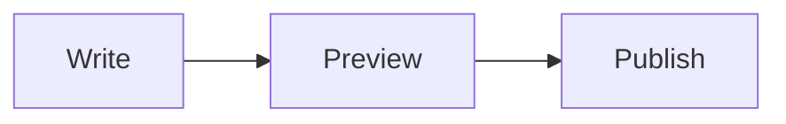
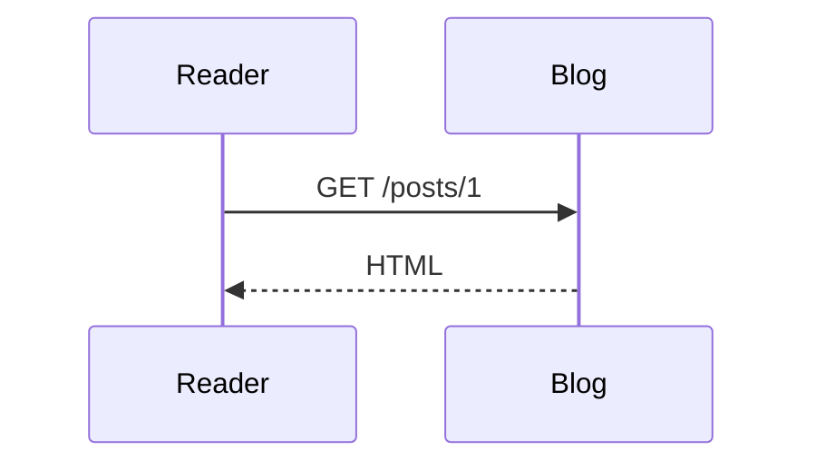

# Writing posts

How to use the post editor as the owner. The public site has no Login link (desktop or mobile menu), so to reach the admin, type `/login` after the site address (for example `https://blog.<domain>/login`) and bookmark it. Once logged in, the navbar shows Create Post and Logout. The page is unlinked and `robots.txt` disallows it, but it is not secret: the API enforces auth. (Link removal verified by reading the code and a build; not checked in a browser.) Then use Create Post (`/create-post`) or Edit Post (`/edit-post/:id`); both use the same editor.

Verification status: this guide is written from the editor's source code. Nothing in the editor UI has been run in a browser (toolbar clicks, selection restore, paste, drag-drop, image picker, preview, layout, Save while uploading, images on the post page). Treat the behaviour below as expected, not confirmed. What was seen to work: `npm run build`, the pure text functions behind the toolbar (Node checks), and login, image upload and fetch through the Vite proxy with `curl`. See [milestones.md](milestones.md#phase-7-markdown-editor-and-image-uploads).

## The editor

- Layout (unverified in a browser): on narrow screens (below the MUI `md` breakpoint) there is a Write / Preview toggle; on wide screens the text box and the preview sit side by side.
- The preview uses the same renderer as the published post, so what you see is what readers get.
- Toolbar buttons (they act on the selected text, or on the current line(s) for line prefixes):

| Button | Result |
|---|---|
| Bold | `**text**` (with no selection, inserts `**bold text**` with the placeholder selected) |
| Italic | `*text*` |
| Heading | prefixes each selected line with `## ` |
| Bullet list | prefixes each selected line with `- ` |
| Numbered list | prefixes each selected line with `1. `, `2. `, ... |
| Quote | prefixes each selected line with `> ` |
| Inline code | `` `code` `` |
| Code block | wraps the selection in a fenced block (three backticks) |
| Link | `[text](url)` with `url` selected, ready to type over |
| Image | opens a file picker (see below) |

- On a narrow screen the toolbar is hidden while Preview is shown; switch back to Write to use it.
- Known quirk: if a selection ends right after a newline, a line-prefix action (heading, lists, quote) does not include the following line. Select up to the last character of the last line instead.
- Save is disabled while an image upload is in progress, so a post cannot be saved with a half-finished image placeholder.

## Supported Markdown

Rendered by `react-markdown` with `remark-gfm`, so GitHub-flavored Markdown works:

- Tables (`| a | b |` with a `---` header row). Wide tables scroll horizontally; cells have borders in the theme divider color.
- Strikethrough: `~~text~~`.
- Task lists: `- [ ] todo` and `- [x] done`. The checkboxes are read-only.
- Bare URLs such as `https://example.com` become links.

Raw HTML is not rendered (no `rehype-raw`): `<div>`, `<b>` or `<script>` typed into a post is escaped and shown as text, never executed. In the post list excerpt, table pipes and task markers are stripped.

Verified: `npm run build` and a server-side render of a sample (table, `<del>`, disabled checkboxes, escaped raw `<script>` and `<b>`, lazy responsive image). Unverified in a browser: the visual styling of tables and task lists, and the dark mode look.

## Diagrams

A fenced block whose language is `mermaid` is drawn as a diagram instead of shown as code. Write the fence with three backticks and `mermaid`:

````

````

````

````

Behavior (from `PostContent.jsx` and `MermaidDiagram.jsx`):

- Only `mermaid` fences are affected. Every other code block, including plain ASCII art in a block with no language or another language, renders as before.
- The Mermaid library is a separate download that the browser fetches only when a post (or the preview) contains a `mermaid` block. Other pages do not load it.
- In the editor preview the diagram re-renders after you stop typing for 400 ms; an older render that finishes late is ignored.
- While loading, and if the diagram has a syntax error, the source is shown as a code block. On error a small note says `Diagram could not be rendered.`
- Wide diagrams scroll horizontally. The diagram colors follow the site's light or dark mode.
- Mermaid runs with `securityLevel: 'strict'`, so scripts and click handlers in a diagram are not allowed. Raw HTML in the rest of the post is still escaped.
- Diagram directives (`%%{init: ...}%%`, anywhere in the block) and a leading `---` frontmatter block (`config:`, `title:`) are not allowed. Such a block is not drawn: it shows as plain code with the note `Diagram directives and frontmatter are not allowed.` Remove the directive or frontmatter to get the diagram. Theme and style options cannot be set this way; the diagram follows the site's light or dark mode.
- Still allowed: plain `%% comment` lines, and `---` inside a diagram such as `A --- B` (only a `---` line at the very start of the block counts as frontmatter).
- The post list excerpt is built from the Markdown text; whether a `mermaid` block shows up there as raw source was not checked (unverified).

Verified: a headless Chrome run against the built app rendered a flowchart and fell back to source for an invalid block, with no CSP violations (reported by the developer, not repeated by the docs pass). After the security fix the developer also reported sequence, ER and state diagrams rendering, and directive and frontmatter blocks falling back with the caption (dark theme). Unverified: the editor preview, the light theme, other diagram types (gantt, class and so on), the 400 ms delay while typing, and the Docker build. See [milestones.md](milestones.md#mermaid-diagrams-2026-10-11).

## Adding images

Images are uploaded to the server and inserted as Markdown. Three ways, all unverified in a browser:

1. Image button: pick one or more files.
2. Paste: copy an image (for example a screenshot) and paste into the text box.
3. Drag and drop: drop image files onto the text box (it shows a dashed outline while dragging).

What happens (from the code):

1. The editor inserts `` at the cursor.
2. The file is sent to `POST /api/v1/uploads` ([api/overview.md](api/overview.md#post-uploads)).
3. On success the placeholder is replaced by ``. The alt text is the file name without extension, with brackets and parentheses removed (`image` if empty).
4. On failure the placeholder is removed and a red message is shown above the text box.

Limits:

- PNG, JPEG, GIF and WebP only. SVG is rejected.
- Maximum 5 MB per image. The editor checks type and size before sending, and the server checks again (it also checks the file's real bytes against its type).
- Only the logged-in owner can upload.

Things to know:

- Images are public: anyone who has the URL can fetch it. There is no listing, and the names are random, but do not upload anything private.
- The server stores the file as-is. EXIF data (camera, GPS location) is kept. Strip it before uploading photos.
- Deleting or editing a post does not delete its images. They stay on disk and in the volume until removed by hand. There is no cleanup tool.
- Images live in the `blog-data` volume under `uploads/`; back that up too ([operations.md](operations.md#backup-and-verify)).
- On the post page and in the preview images scale down to the column width and load lazily. In the post list card, image Markdown is dropped from the excerpt.

## Markdown cheat sheet

```
# Heading 1
## Heading 2
### Heading 3

**bold**  *italic*

- bullet
- another

1. first
2. second

> a quote

`inline code`

    ```
    code block (fence with three backticks on their own lines)
    ```

    ```mermaid
    flowchart LR
      A --> B
    ```
    (a fence with the language mermaid is drawn as a diagram)

[link text](https://example.com)


A blank line starts a new paragraph.
---
(three dashes on their own line: horizontal rule)
```

(In the code block rows above, the fences is indented only so it displays inside this sample; write the three backticks at the start of the line in a post.)
